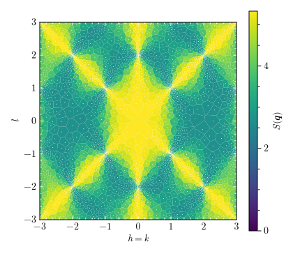
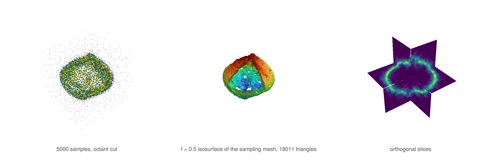

# AdaptivePort.jl

[](https://github.com/NilsNiggemann/AdaptivePort.jl/actions/workflows/CI.yml)
[](https://NilsNiggemann.github.io/AdaptivePort.jl/dev/)

Sample an expensive function where it is most informative instead of on a fixed grid. AdaptivePort.jl is an
independent Julia implementation of [Python Adaptive](https://github.com/python-adaptive/adaptive). It is an
early-stage, experimental package with much AI-generated code.

## Installation

The package is not registered; install it from the git URL:

```julia
using Pkg
Pkg.add(url = "https://github.com/NilsNiggemann/AdaptivePort.jl")
```

## Quick start

A learner decides where to sample, a runner evaluates the function and tells the learner the values.

```julia
using AdaptivePort

learner = Learner1D(x -> tanh(50x); bounds = (-1, 1))
BlockingRunner(learner; tol = 0.02, max_npoints = 500)
data = result(learner)          # (x = sorted points, y = values)
```

```julia
learner = Learner2D((x, y) -> exp(-((hypot(x, y) - 0.6) / 0.05)^2); bounds = ((-1, 1), (-1, 1)))
BlockingRunner(learner; max_npoints = 800)
data = result(learner)          # (points = vector of (x, y), values = vector)
tris = triangles(learner)       # Delaunay triangles as index triples into data.points
```

You can also drive a learner yourself with `ask(learner, n)` and `tell!(learner, x, y)`.

## Examples

Adaptive sampling of a two-dimensional cut of spin-ice structure factor:



Adaptive sampling of a three-dimensional function:



## Learners and features

- `Learner1D`, `Learner2D`, `LearnerND`: sampling on an interval, a rectangle and an N-dimensional box; scalar or
  vector-valued functions (`vdim` keyword).
- `AverageLearner`, `AverageLearner1D`: noisy functions. `IntegratorLearner`: adaptive quadrature.
  `SequenceLearner`: a fixed list of inputs.
- `BalancingLearner`, `DataSaver`: serve several learners with one runner; keep extra function output.
- Runners with goals (`tol`, `max_npoints`, `duration`, `end_time`), executors for threads, Distributed.jl,
  Dagger.jl and MPI.jl, checkpoint and resume, `to_table`, `save_data` and `load_data!` (CSV or `.jls`).

Runnable scripts are in [`examples/`](examples). Plotting recipes (CairoMakie, not a dependency) are in the docs.

## Documentation

[Documentation](https://NilsNiggemann.github.io/AdaptivePort.jl/dev/): learner pages, runners and parallel
execution, saving, plotting, performance, and the Compatibility page that lists how this package follows and
differs from Python Adaptive.

## Known issues

- As in the Python implementation, the adaptive sampler targets the region where the loss is highest, which can
  lead to undersampling for symmetric functions. See `examples/learner1d_plot.jl`.

## Attribution

AdaptivePort.jl is an independent Julia implementation of
[Python Adaptive](https://github.com/python-adaptive/adaptive). The implementation follows the algorithms and API
conventions of the original project, which is distributed under the BSD 3-Clause License.

Copyright (c) 2017-2023, Adaptive authors.
