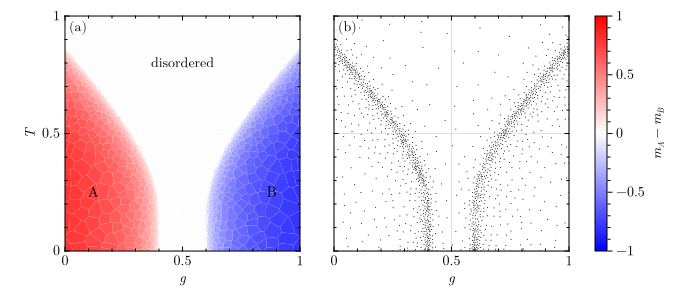

# Phase diagram on 4 cluster nodes

This example maps the phase diagram of a model with two ordered phases and one disordered phase, using
[`Learner2D`](@ref) with 128 workers on 4 nodes of a Slurm cluster. It has two versions: with
[Distributed.jl workers](../runners/parallel.md#Distributed.jl-workers) and with
[MPI ranks](../runners/parallel.md#MPI.jl). Both also run on a laptop. It builds on [Getting started](../getting_started.md) and
[Parallel execution](../runners/parallel.md).



*(a) Voronoi cells of 1500 samples, coloured by $m_A - m_B$: red is phase A, blue phase B, white disordered.
(b) The samples alone. They gather on the phase boundaries, where an order parameter sets in.*

The scripts are in
[`examples/phase_diagram/`](https://github.com/NilsNiggemann/AdaptivePort.jl/tree/main/examples/phase_diagram):

| File | Does |
|:-----|:-----|
| `model.jl` | the model: `order_parameters(g, T)` returns $(m_A, m_B)$ |
| `run_distributed.jl` | runs the learner on Distributed.jl workers and saves `phase_diagram.csv` |
| `job_distributed.sh` | Slurm job: 4 nodes × 32 tasks, one worker per task |
| `run_mpi.jl` | the same with [`MPIExecutor`](@ref) |
| `job_mpi.sh` | Slurm job: 4 nodes × 32 MPI ranks |
| `plot.jl` | loads `phase_diagram.csv` and draws the figure above |

## The model

The model is a mean-field transverse-field Ising magnet with two competing orders, small enough to read in a
minute. A coupling ratio $g \in [0, 1]$ shifts weight from a coupling $J_A = 1 - g$, which favours order A, to a
coupling $J_B = g$, which favours order B. A transverse field $\Gamma = 0.6$ disorders both. Each order parameter
solves the mean-field equation

$$m = \frac{J m}{h} \tanh\frac{h}{T}$$

with $h = \sqrt{(J m)^2 + \Gamma^2}$. Order needs $J > \Gamma$ at $T = 0$, so neither order survives for
$0.4 < g < 0.6$: there the system stays disordered down to $T = 0$. At $g = 0$ order A sets in below
$T_c = \Gamma / \mathrm{artanh}\thinspace\Gamma \approx 0.87$. The function returns both order parameters, so the
learner is told a 2-vector at each point:

```julia
include("model.jl")
order_parameters(0.1, 0.2)    # (0.745..., 0.0): phase A
order_parameters(0.5, 0.2)    # (0.0, 0.0): disordered
```

!!! tip "Learn all order parameters at once"
    Pass `vdim = 2` (one per order parameter) instead of a single combined number. The learner then keeps every
    order parameter in the data and refines wherever *any* of them changes, so it finds the boundary of each
    ordered phase. In other models a hand-made scalar can hide a transition, for example when two orders map to
    the same value.

In a real study `order_parameters` would run a simulation for minutes or hours. Here `cost = 0.05` adds 50 ms of
`sleep` per call to mimic that.

## Distributed.jl version

`run_distributed.jl` starts one worker per Slurm task and runs the learner on the driver process:

```julia
using Distributed, SlurmClusterManager, AdaptivePort

if haskey(ENV, "SLURM_JOB_ID")
    addprocs(SlurmManager())  # one worker per Slurm task, on all nodes of the allocation
else
    addprocs(4)               # laptop
end

@everywhere using AdaptivePort
@everywhere include($(joinpath(@__DIR__, "model.jl")))
@everywhere f(g, T) = order_parameters(g, T; cost = 0.05)  # f must exist on every worker

path = joinpath(@__DIR__, "phase_diagram.csv")
learner = Learner2D(f; bounds = ((0.0, 1.0), (0.0, 1.0)), vdim = 2)  # (g, T) -> (m_A, m_B)
isfile(path) && load_data!(learner, path)  # resume an earlier run

BlockingRunner(learner; max_npoints = 1500, duration = 110 * 60, executor = DistributedExecutor(),
    checkpoint = path, checkpoint_interval = 60)
```

The job script asks for 4 nodes with 32 tasks each and runs the driver once. `SlurmManager` launches the 128
workers on all 4 nodes itself:

```bash
#!/bin/bash
#SBATCH --job-name=phase-diagram
#SBATCH --nodes=4
#SBATCH --ntasks-per-node=32         # 4 x 32 = 128 Distributed workers
#SBATCH --cpus-per-task=1
#SBATCH --time=02:00:00

# precompile once here, not in 128 workers at the same time
julia --project=examples -e 'using Pkg; Pkg.precompile()'

# the driver runs once; SlurmManager starts the workers on all nodes itself
julia --project=examples examples/phase_diagram/run_distributed.jl
```

Submit it from the repository root with `sbatch examples/phase_diagram/job_distributed.sh`. On a laptop, run
`julia --project=examples examples/phase_diagram/run_distributed.jl` (4 local workers, about 45 s).

## MPI version

With MPI all ranks run the same script. Rank 0 runs the learner and all other ranks evaluate `f`.
No `@everywhere` is needed, because every rank executes the whole file:

```julia
using MPI, AdaptivePort
MPI.Init()

include(joinpath(@__DIR__, "model.jl"))
f(g, T) = order_parameters(g, T; cost = 0.05)

path = joinpath(@__DIR__, "phase_diagram.csv")
learner = Learner2D(f; bounds = ((0.0, 1.0), (0.0, 1.0)), vdim = 2)

MPIExecutor(learner.f) do executor           # ranks > 0 serve f here and skip the block
    isfile(path) && load_data!(learner, path)  # inside the block: only rank 0 needs the data
    BlockingRunner(learner; max_npoints = 1500, duration = 110 * 60, executor,
        checkpoint = path, checkpoint_interval = 60)
end
```

The job script starts the 128 ranks with `srun`:

```bash
#!/bin/bash
#SBATCH --job-name=phase-diagram-mpi
#SBATCH --nodes=4
#SBATCH --ntasks-per-node=32         # 128 ranks: rank 0 runs the learner, 127 evaluate
#SBATCH --cpus-per-task=1
#SBATCH --time=02:00:00

# precompile once here, not in 128 ranks at the same time
julia --project=examples -e 'using Pkg; Pkg.precompile()'

srun julia --project=examples examples/phase_diagram/run_mpi.jl
```

On a cluster, MPI.jl must use the cluster's MPI library; see [Clusters](../runners/clusters.md#MPI-ranks). The job
scripts precompile but do not download: run `julia --project=examples -e 'using Pkg; Pkg.instantiate()'` once on
the login node, since compute nodes often have no internet access.

On a laptop, with MPI.jl's bundled MPICH and 5 ranks (4 evaluating):

```julia
using MPI
MPI.mpiexec(m -> run(`$m -n 5 julia --project=examples examples/phase_diagram/run_mpi.jl`))
```

## Which version should I use?

Use Distributed.jl unless your cluster or your `f` already relies on MPI; the
[comparison](../runners/parallel.md#Distributed.jl-versus-MPI) lists the differences.

## Checkpoints, time limits and resuming

Both scripts follow the [cluster checklist](../runners/clusters.md):

- `checkpoint = path` with `checkpoint_interval = 60` saves the data every minute and when the runner stops.
- `duration = 110 * 60` stops the runner after 110 minutes, inside the 2-hour job limit, so it can stop cleanly
  and write the final checkpoint.
- `isfile(path) && load_data!(learner, path)` resumes: submitting the same job again continues from the saved
  points. Raise `max_npoints` to go further.

!!! danger "Resume with the same model and bounds"
    `load_data!` replays the saved points into the new learner without checking which function produced them.
    If you change the model between runs, the old and new values get mixed. Points outside new bounds make
    `load_data!` throw an `ArgumentError` partway, leaving the learner partly filled; build a new learner after
    the error. Delete `phase_diagram.csv`, or use a new path, when you change either.

## Number of workers

The learner runs on one process, but the runner asks for all free worker slots at once, so one triangulation
serves a whole batch. With the 50 ms of this demo, a local test with 128 tasks keeps the workers about half busy;
with a simulation that takes seconds or more per point, the learner's cost is negligible.

!!! note "Many workers place points less well"
    Points of one batch are chosen without each other's values. With 128 workers the same 1500 points reach a
    somewhat higher loss than with 4 (here about 0.003 versus 0.002). Use `max_npoints` or `tol` to fix the
    accuracy, not the wall-clock time alone.

## Plot the result

`plot.jl` loads `phase_diagram.csv` into a fresh learner and draws the figure at the top (Voronoi cells coloured by
$m_A - m_B$, see [Plotting results](plotting.md#Voronoi-cells)). If `phase_diagram.csv` is missing, `plot.jl` first
runs the scan on this machine, without the artificial cost:

```bash
julia --project=examples examples/phase_diagram/plot.jl
```
