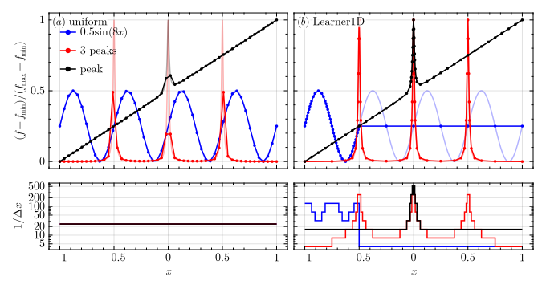
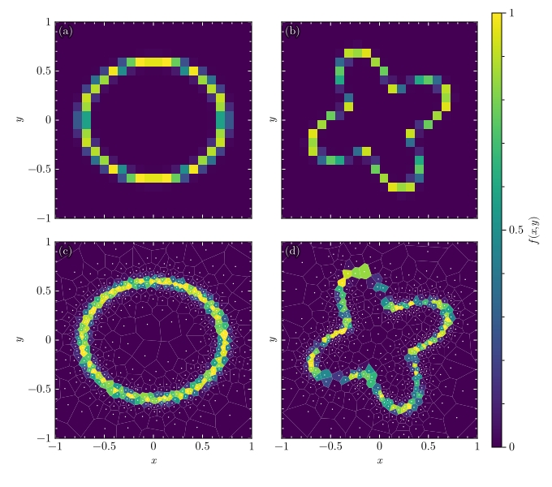
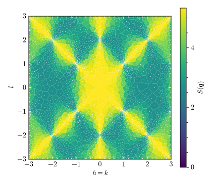
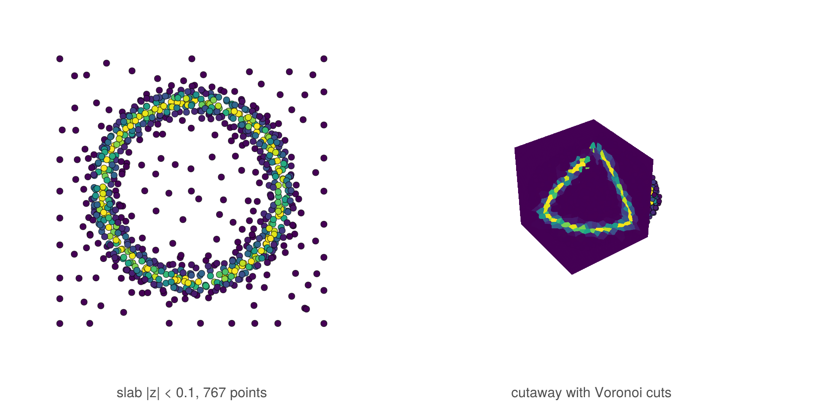

# Plotting results

AdaptivePort.jl has no plotting code and no Makie dependency: the data accessors give everything a plot needs,
and the recipes below use [CairoMakie](https://docs.makie.org) and
[DelaunayTriangulation.jl](https://github.com/JuliaGeometry/DelaunayTriangulation.jl). The scripts
`examples/learner1d_plot.jl`, `examples/learner2d_rings.jl`, `examples/learner2d_spinice.jl` and
`examples/learnernd_shell.jl` produce the figures of these docs; run them with `julia --project=examples`.
They use the `MakieHelpers` theme; the recipes below use plain CairoMakie.

`result(learner)`, `triangles(learner)` and `to_table(learner)` return copies and never change the learner, so
you can plot while a runner is working.

!!! warning "Plotting during a run"
    Read the learner only from the task that started the runner (usually the REPL), never from another
    thread. See [Asynchronous runs](../runners/runners.md#Asynchronous-runs).

## One dimension

`result(learner)` is `(x, y)` sorted by `x`: draw the line through the samples and mark the points to show where
the learner sampled.

```julia
using AdaptivePort, CairoMakie

learner = Learner1D(x -> tanh(50x); bounds = (-1, 1))
BlockingRunner(learner; max_npoints = 50)
data = result(learner)

fig = Figure(size = (500, 300))
ax = Axis(fig[1, 1]; xlabel = L"x", ylabel = L"f(x)")
lines!(ax, data.x, data.y; color = :black)
scatter!(ax, data.x, data.y; color = :red, markersize = 5)
fig
```



## Two dimensions

`result(learner)` is `(points, values)` with `points` a vector of `(x, y)` tuples; `triangles(learner)` is the
Delaunay triangulation as index triples into `points`.

```julia
using AdaptivePort, CairoMakie
import DelaunayTriangulation as DT

f(x, y) = exp(-((hypot(x, y) - 0.6) / 0.05)^2)
learner = Learner2D(f; bounds = ((-1, 1), (-1, 1)))
BlockingRunner(learner; max_npoints = 800)
data = result(learner)
xy = Point2f.(data.points)
z = data.values
tris = reduce(vcat, [collect(t)' for t in triangles(learner)])   # n x 3 matrix of indices
```

Sample points on their own, and the triangulation as a wireframe:

```julia
fig = Figure(size = (900, 320))
ax1 = Axis(fig[1, 1]; aspect = 1, title = "samples")
scatter!(ax1, xy; color = :black, markersize = 3)
ax2 = Axis(fig[1, 2]; aspect = 1, title = "triangulation")
mesh!(ax2, xy, tris; color = z, colormap = :viridis, shading = NoShading)       # filled, linear interpolation
edges = [xy[t[k]] for t in triangles(learner) for k in (1, 2, 2, 3, 3, 1)]   # three edges per triangle
linesegments!(ax2, edges; color = (:black, 0.3), linewidth = 0.5)
```

The filled mesh is the piecewise-linear interpolant. For smooth contours, interpolate onto a grid
(for example with [Interpolations.jl](https://github.com/JuliaMath/Interpolations.jl) or
NaturalNeighbours.jl, which are not dependencies here) and use `contourf!` or `heatmap!`; the learner does not
provide an interpolator.

### Voronoi cells

Colouring each sample's Voronoi cell shows the sampling density directly and needs no interpolation. This is
what `examples/learner2d_rings.jl` does, with the cells clipped to the convex hull:

```julia
vorn = DT.voronoi(AdaptivePort.delaunay(data.points); clip = true)
cells = [Point2f.(DT.get_polygon_coordinates(vorn, j)) for j in eachindex(data.points)]
fig = Figure(size = (400, 400))
ax = Axis(fig[1, 1]; aspect = 1)
poly!(ax, cells; color = z, colormap = :viridis)
scatter!(ax, xy; color = :white, markersize = 2)
```

`AdaptivePort.delaunay(points)` is the triangulation helper the package itself uses (unexported). Pass it
points in the order of `result(learner).points`, so that cell `j` belongs to sample `j`. The
[phase diagram](phase_diagram.md) uses the same recipe for a vector-valued learner, colouring each cell by a
combination of its components.





The second figure shows 2000 samples of the neutron structure factor $S(\mathbf{q})$ of nearest-neighbour
classical spin ice in the self-consistent Gaussian approximation ($T = 0.001$ in units of the effective Ising
coupling), in the plane $q_x = q_y$ of reciprocal space. The samples concentrate on the pinch points
(bow-ties) at the reciprocal-lattice points.

## More than two dimensions

For [`LearnerND`](@ref), `simplices(learner)` gives the simplices; `examples/learnernd_shell.jl` draws a
slab of a three-dimensional sampling together with a Voronoi cutaway:


