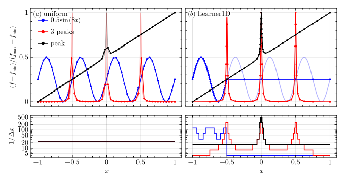
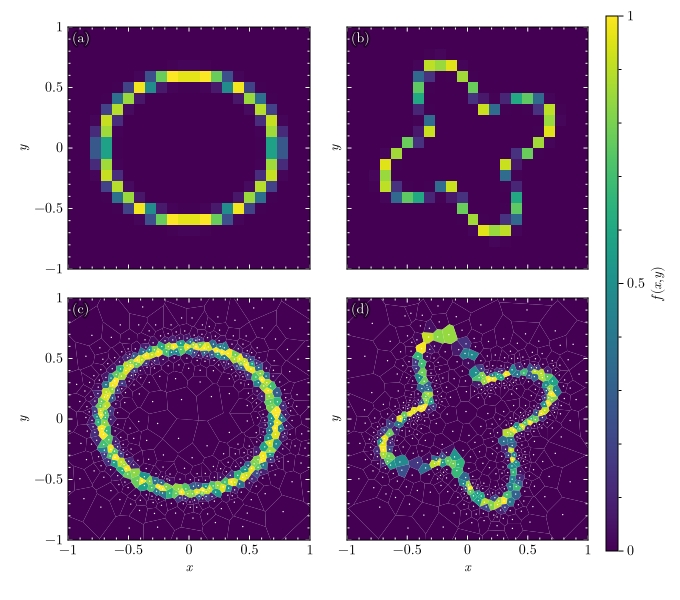
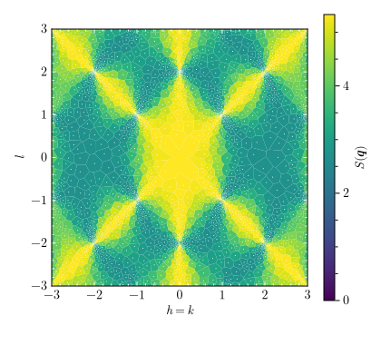

# AdaptivePort.jl

Julia port of [Python Adaptive](https://github.com/python-adaptive/adaptive): sample a function
where it is most informative instead of on a fixed grid. All learners implement the
[`AbstractLearner`](@ref) interface.

## Learners

- [`Learner1D`](@ref) and [`Learner2D`](@ref) (this page): functions on an interval and on a rectangle.
- [`LearnerND`](@ref) ([page](learnernd.md)): functions on a box in $N$ dimensions.
- [`AverageLearner`](@ref) ([page](average_learner.md)): the mean of a noisy number.
- [`AverageLearner1D`](@ref) ([page](average_learner1d.md)): a noisy function on an interval.
- [`IntegratorLearner`](@ref) ([page](integrator.md)): the integral of a function on an interval.
- [`SequenceLearner`](@ref) ([page](sequence.md)): a plain map over a fixed list of inputs.
- [Runners](#Runners) evaluate the function for any of them.

## Workflow

The learner decides *where* to sample; you decide *how* to evaluate the function.

```julia
using AdaptivePort

f(x) = sin(8x) + 0.2cos(23x)
learner = Learner1D(f; bounds=(-1, 1))

while !done(learner; tol=0.05) && npoints(learner) < 1000
    points = ask(learner, 1)
    isempty(points) && break
    for x in points
        tell!(learner, x, f(x))
    end
end

data = result(learner)   # (x = sorted Vector, y = values)
```

The full script is `examples/learner1d.jl`; run it from the repository root with
`julia --project=. examples/learner1d.jl`.

Uniform versus adaptive sampling of three sharp functions with the same number of evaluations
(50), from `examples/learner1d_plot.jl` (run with `julia --project=examples`):



- `ask(learner, n)` returns up to `n` new points. The first points are the bounds; after that each
  point is the midpoint of the interval with the largest loss. The returned points are marked
  *pending*, so further calls never return them again, even before they are evaluated. Pass
  `tell_pending=false` to only peek.
- `tell!(learner, x, y)` records an evaluation. Points outside the bounds throw an `ArgumentError`;
  a repeated `x` is ignored and the first value is kept.
- `loss(learner)` is the largest interval loss, or `Inf` while a bound is unevaluated.
  `done(learner; tol)` is `loss(learner) <= tol`.
- `result(learner)` returns `(x, y)` copies sorted by `x`; `npoints(learner)` counts them.

## Vector-valued functions

`Learner1D`, `Learner2D` and [`LearnerND`](@ref) accept functions with several output components:
pass `vdim = M` to the constructor (default 1, plain numbers). The values are then stored as
`NTuple{M,T}` and `tell!` takes any iterable of length $M$ (a tuple, a vector, ...); a wrong length
throws `ArgumentError`. `vdim` is fixed at construction.

```julia
f(x) = (sin(3x), tanh(60 * (x - 0.3)))
learner = Learner1D(f; bounds=(-1, 1), vdim=2)
for x in ask(learner, 5)
    tell!(learner, x, f(x))
end
result(learner).y   # Vector of 2-tuples
```

All components share one set of points. The value scale is the largest range over the components
(upstream does the same), so a component with a small range does not steer the sampling. Custom
losses get tuples: `Learner1D` calls `loss_per_interval(xs, ys)` with `ys` a pair of `NTuple{M}` of
*scaled* values, `Learner2D` calls `loss_per_triangle(points, values, triangles)` with raw
`NTuple{M}` values (and scaled points), as for scalars. The default losses handle tuples.
`examples/vector.jl` runs both learners with `vdim = 2`.

## Runners

A runner does the `ask` → evaluate → `tell!` loop for you, using the function stored in the
learner (`f(x)` for [`Learner1D`](@ref), `f(x, y)` for [`Learner2D`](@ref)): construct a learner,
construct a runner, wait, then read the result. Learners decide *where* to sample; runners decide
*when and how* to evaluate. The manual loop above stays fully supported.

```julia
learner = Learner1D(f; bounds=(-1, 1))
runner = BlockingRunner(learner; tol=0.02, max_npoints=500)   # returns when done
data = result(learner)

runner = AsyncRunner(learner; tol=0.01)   # returns immediately
# ... other work ...
wait(runner)
```

`examples/runners.jl` shows blocking, asynchronous and parallel runs
(`julia -t 4 --project=. examples/runners.jl`).

- **Stopping.** `tol` stops once `loss(learner) <= tol`; `max_npoints` stops once the learner holds
  that many points, and batches are cut short so that it is never exceeded. A runner also stops
  when `ask` returns no points (the learner has reached its numerical resolution), so it cannot
  spin forever. `BlockingRunner` requires at least one goal; an `AsyncRunner` without one runs until
  [`cancel!`](@ref).
- **Batches.** Each iteration asks for `batch_size` points (default 1, or `Threads.nthreads()` with
  `parallel=true`), evaluates all of them, then tells all results. Points are requested with
  `tell_pending=false`, so the learner never holds pending points that a failed or cancelled batch
  would leave behind. Smaller batches are more adaptive.
- **Parallel evaluation.** `parallel=true` evaluates the points of a batch in separate tasks
  (`Threads.@spawn`). Start Julia with several threads (`julia -t auto`), and make sure `f` is safe
  to call concurrently. The learner itself is never touched concurrently: only the runner loop
  calls `ask` and `tell!`, after the whole batch has been evaluated.
- **Asynchronous execution.** The runner loop is an `@async` task pinned to the caller's thread;
  evaluations run in spawned tasks. So the learner changes only when the caller yields (`sleep`,
  `wait`, I/O), and reading `runner.learner` from the calling task needs no lock. Do not read it from
  another thread while the runner is running.
- **Progress.** [`status`](@ref) is `:running`, `:finished`, `:cancelled` or `:failed`; progress is
  `npoints(runner.learner)` and `loss(runner.learner)`.
- **Errors.** If `f` throws, the rest of the batch is still evaluated and its successful results
  are told; then the runner fails with an [`EvaluationError`](@ref) carrying the failing `point` and
  the original exception with its backtrace. `wait(runner)` (and `BlockingRunner`) rethrows it.
- **Cancellation.** [`cancel!`](@ref) stops the runner between batches: the batch in flight finishes
  and is told first.

## Pending points and the shared interface

`LearnerND`, `AverageLearner`, `AverageLearner1D`, `IntegratorLearner` and `SequenceLearner`
implement the full interface below; `Learner1D` and `Learner2D` implement the core part (the
[`AbstractLearner`](@ref) docstring lists both).

- [`pending_points`](@ref)`(learner)` returns the points handed out by `ask` and not yet told.
- [`remove_unfinished!`](@ref)`(learner)` forgets them, so that `ask` can hand them out again. Use it
  after abandoned evaluations.
- `loss(learner; real = false)` counts pending points as if they were evaluated; `real = true`
  (default) uses told data only.
- `AdaptivePort.ask_with_improvements(learner, n)` returns upstream's pair `(points,
  loss_improvements)`; `ask` returns only the points.
- Some learners know when they are finished (the mean is accurate enough, the integral converged,
  every element is told). They define `done(learner)` without `tol` (`AdaptivePort.has_own_goal`
  is `true`), and a runner without `tol` stops on that; `BlockingRunner` then needs no other goal.

## Refinement algorithm

Each interval between neighbouring evaluated points has a loss, by default the length of the
straight segment joining its endpoints, in coordinates scaled by the width of the bounds and the
observed range of `y`. This is upstream's `default_loss`. Steep regions have long segments and get
refined first. The scaled `y`-range is updated lazily: all losses are recomputed only when the range
more than doubles, as upstream does.

`ask` bisects the highest-loss interval, repeatedly. An interval that already contains pending
points is split into sub-intervals that each carry a share of its loss proportional to their width.
Ties go to the leftmost interval. Intervals narrower than about `eps` times the bounds have zero
loss and are never split, so `ask` returns fewer points (eventually none) once the resolution is
exhausted. A `NaN` or infinite interval loss is ranked by the interval's width instead.

## Learner2D

```julia
using AdaptivePort

f(x, y) = sin(5x) * cos(7y) + 0.3 * exp(-20 * ((x - 0.3)^2 + (y + 0.2)^2))
learner = Learner2D(f; bounds=((-1, 1), (-0.75, 0.75)))

while !done(learner; tol=0.01) && npoints(learner) < 3000
    points = ask(learner, 5)
    isempty(points) && break
    for (x, y) in points
        tell!(learner, (x, y), f(x, y))
    end
end

data = result(learner)   # (points = Vector of (x, y) tuples, values = Vector), in tell order
tris = triangles(learner) # counter-clockwise index triples into data.points
```

The full script is `examples/learner2d.jl`.

Two thin rings sampled with 784 points on a uniform grid (top) and by `Learner2D` (bottom, Voronoi
cells of the samples), from `examples/learner2d_rings.jl` (`budget = 28^2`):





2000 samples of the neutron structure factor ``S(\mathbf{q})`` of nearest-neighbour classical spin ice in the
self-consistent Gaussian approximation (``T = 0.001`` in units of the effective Ising coupling), in the plane
``q_x = q_y`` of reciprocal space (Voronoi cells of the samples, samples in white). The samples concentrate on
the pinch points (bow-ties) at the reciprocal-lattice points.
`examples/learner2d_spinice.jl` produces the figure.

- Points are `NTuple{2}` tuples `(x, y)` everywhere: `ask` returns them, `tell!` takes them.
- `bounds = ((xmin, xmax), (ymin, ymax))`, finite with `xmin < xmax`, `ymin < ymax`; otherwise
  `ArgumentError`. Any aspect ratio and coordinate scale works: the learner works in scaled
  coordinates where the domain is $[-1/2, 1/2]^2$, as upstream.
- The first four points are the corners, in the order $(x_0, y_0)$, $(x_0, y_1)$, $(x_1, y_0)$,
  $(x_1, y_1)$. Their convex hull is the whole rectangle, so once they are evaluated the
  triangulation covers the domain and no boundary region can be neglected.
- `tell!(learner, (x, y), z)` throws for points outside the bounds. Telling a point again
  overwrites its value (as upstream; `Learner1D` keeps the first value, also as upstream). A
  non-finite `z` is stored but left out of the triangulation.
- `loss(learner)` is `Inf` until the four corners are evaluated, then the largest triangle loss
  (below). `done(learner; tol)` is `loss(learner) <= tol`.
- `result(learner)` returns copies `(points, values)` in tell order; `triangles(learner)` returns
  the Delaunay triangles of the evaluated finite-valued points as index triples into `points`.

### Triangulation

The Delaunay triangulation of the (scaled) points is built with
[DelaunayTriangulation.jl](https://github.com/JuliaGeometry/DelaunayTriangulation.jl), rebuilt from
scratch whenever it is needed (about 15 ms per `ask` at 1000 points). `src/triangulation.jl` is
the only file that uses the package.

### Loss and refinement

The loss of a triangle with area $A$ (in scaled coordinates) is upstream's `default_loss`,
$L = d\sqrt{A} + 0.3A$. Here $d$ estimates the error of linear interpolation on the triangle:
with values $v_i$ normalised by their total range and gradients $g_i$ estimated at the vertices,
$d = \sum_i \max_j \lvert v_i + g_i \cdot (p_j - p_i) - v_j \rvert$ over the vertices $i, j$. The
gradients are a port of scipy's `estimate_gradients_2d_global` (which upstream uses), checked
against scipy to $10^{-14}$. The $d$ term refines curved regions; the $0.3A$ term keeps refining
flat ones. Because coordinates and values are normalised, the loss is a relative quantity,
invariant under rescaling $x$, $y$ or $f$; `tol` in `done` is in these units. It decreases as
points are added, though not monotonically: adding a point changes the gradient estimates and
the value range.

`ask` triangulates the evaluated points together with the pending ones (whose values are linearly
interpolated from the evaluated data, so they add no deviation but split triangles), ranks the
triangles by loss and takes one new point from each of the `n` worst. In a triangle whose
badness $\sqrt{3}\ell^2/(4A)$ ($\ell$ the longest edge) exceeds 5 that point is the midpoint of the
longest edge, otherwise the centroid. If too few distinct points come out, the triangulation is
rebuilt including them and the step repeats.

## Deviations from Python Adaptive

These are intentional for now and may be revisited.

All learners:

- `ask` returns only the points; `AdaptivePort.ask_with_improvements` gives upstream's pair.
- `vdim` is fixed at construction. Vector values are `NTuple`s, and `tell!` throws `ArgumentError`
  for a value of the wrong length.
- `tell!` with a point outside the bounds throws everywhere; upstream stores and ignores it.

`Learner1D`:

- Non-finite components are excluded from the $y$-range per component; upstream includes `inf`.
  The internal `AdaptivePort.update_value!` never shrinks the range, as upstream.
- `ask` bisects; upstream splits one interval into `k` equal parts when it receives several points.
- `done(learner; tol)` exists; upstream expresses goals through runners (`loss_goal`).
- Not yet implemented in `Learner1D`: neighbour-based losses (`nth_neighbors`, curvature) and
  optimized bulk `tell_many`.

`LearnerND` (see [its page](learnernd.md)):

- No convex-hull bounds, interpolator, plotting, `anisotropic`, `triangulation_backend` or
  neighbour-based losses (`triangle_loss`, `curvature_loss_function`).
- Non-finite values throw `ArgumentError`. `loss` is `Inf` until all corners are told.
- `loss(real = false)` is implemented (upstream returns the real loss): a simplex with pending points
  counts as its largest sub-simplex.
- `remove_unfinished!` rebuilds the simplex queue; upstream can lose subdivided simplices.
- The random start point uses `Xoshiro(1)`, so it differs from upstream.
- `ask(...; tell_pending = false)` snapshots the learner and restores it.
- The triangulation supports dimension 1 and builds the initial triangulation by insertion instead
  of scipy (the same result for points in general position). A failed insertion throws and leaves
  the triangulation unchanged. Asked points are clamped to the box.

`AverageLearner` (see [its page](average_learner.md)):

- `ask` hands out the smallest seeds that are neither told nor pending; upstream starts at
  told plus pending and may skip a free low seed.
- `result` is `(mean, std, n)`. Float64 only.

`AverageLearner1D` (see [its page](average_learner1d.md)):

- An undersampled $x$ is picked as the smallest such $x$; upstream picks an arbitrary set element.
- Pending bounds are excluded from re-asking; upstream re-asks a pending bound.
- The resample exclusion (`error <= min_error` or `nsamples >= max_samples`) is evaluated on demand,
  not dropped permanently.
- `max_samples` is not enforced for `ask(l, n > 1)` (upstream neither).
- The loss improvement of a resample uses the real neighbour losses.
- `npoints` counts distinct $x$ and `nsamples` all samples, so a runner's `max_npoints` counts
  distinct $x$.
- No `tell_many_at_point`, plotting or dataframes.

`IntegratorLearner` (see [its page](integrator.md)):

- `result` is `(integral, error, npoints)`. Float64 only.
- `ask(...; tell_pending = false)` re-queues the asked points (no snapshot); `tell!` drops told
  points from the queue. `tell_pending!` and `remove_unfinished!` are no-ops, as upstream.
- `DivergentIntegralError` propagates unchanged from `tell!` and `ask`; upstream converts it in `ask`.
- `ask` returns fewer than `n` points when the intervals run out and throws only when it has none.
- Kept upstream limitation: if values are told out of order, or asked in batches (as the parallel
  runner does), `done` can fire with an error estimate well above `tol` (upstream issue #96).
  Example: `exp` on $(0, 1)$, `tol = 1e-10`, batch size 8 gives an error estimate of $1.4 \cdot
  10^{-6}$ at 40 points, identical to upstream. The result is still within its reported error.

`SequenceLearner` (see [its page](sequence.md)):

- The index is 1-based.
- `result` is `(indices, values)` of the told elements and works before completion; upstream raises
  until done and returns the values only.
- `value_type` keyword; no dataframes.

Runners:

- One `Runner` type; `BlockingRunner` and `AsyncRunner` are functions that construct and start it.
  Execution uses Julia tasks and threads instead of `concurrent.futures` executors; there is no
  `executor`/`ntasks` argument, and distributed execution is not supported yet.
- Batch-synchronous: a batch is evaluated completely before the next `ask`. Upstream refills an
  executor slot as soon as one point finishes, which keeps workers busier when evaluation times vary.
- Goals: only `tol` (`loss_goal`) and `max_npoints` (`npoints_goal`); no custom `goal` callable,
  `end_time_goal` or `duration_goal`. `max_npoints` caps the batch size, so it is never overshot.
- Errors: no `retries`; the first failure stops the runner with an `EvaluationError` after telling
  the batch's successful results. Upstream wraps it in a `RuntimeError`.
- `cancel!` takes effect between batches; upstream cancels the running futures and discards their
  points.
- Learners with their own goal stop without `tol`, and `BlockingRunner` accepts them without any goal.
- No logging, saving, `overhead`, `elapsed_time` or live plotting.

`Learner2D` additionally:

- has no persistent point stack (`stack_size`): every `ask` recomputes the triangle losses, which
  equals upstream with `stack_size = 1`. Upstream's default (10) hands out points chosen from an
  older triangulation.
- may pick a different diagonal for cocircular points (e.g. the four corners), so point sequences
  differ from upstream after the corners, while the losses reached are comparable.
- ships only `default_loss`; `uniform_loss`, `resolution_loss_function`,
  `minimize_triangle_surface_loss` and `thresholded_loss_function` are not ported (pass any
  `(points, values, triangles) -> losses` function as `loss_per_triangle`).
- does not provide an interpolator (`ip()`) or
  `interpolated_on_grid`.
- ignores non-finite values in the triangulation; upstream propagates them into the loss.

## API

```@docs
AdaptivePort
AbstractLearner
Learner1D
Learner2D
ask
tell!
tell_pending!
loss
done
result
npoints
default_loss
triangles
Runner
BlockingRunner
AsyncRunner
EvaluationError
status
cancel!
Base.wait(::Runner)
pending_points
remove_unfinished!
```

### Internals

```@docs
AdaptivePort.deviations
AdaptivePort.estimate_gradients
AdaptivePort.choose_point_in_triangle
AdaptivePort.delaunay
AdaptivePort.delaunay_triangles
AdaptivePort.signed_area
AdaptivePort.interpolate_linear
AdaptivePort.ask_with_improvements
AdaptivePort.has_own_goal
AdaptivePort.update_value!
```
