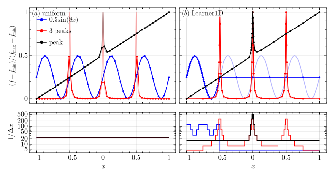

# Learner1D

Adaptive sampling of a function on an interval; see also the [overview](index.md#Learners).

## The ask and tell loop

The learner decides *where* to sample; you decide *how* to evaluate the function.

```julia
using AdaptivePort

f(x) = sin(8x) + 0.2cos(23x)
learner = Learner1D(f; bounds=(-1, 1))

while !done(learner; tol=0.05) && npoints(learner) < 1000
    points = ask(learner, 1)
    isempty(points) && break
    for x in points
        tell!(learner, x, f(x))
    end
end

data = result(learner)   # (x = sorted Vector, y = values)
```

The full script is `examples/learner1d.jl`; run it from the repository root with
`julia --project=. examples/learner1d.jl`.

Uniform versus adaptive sampling of three sharp functions with the same number of evaluations
(50), from `examples/learner1d_plot.jl` (run with `julia --project=examples`):



- `ask(learner, n)` returns up to `n` new points. The first points are the bounds; after that each
  point is the midpoint of the interval with the largest loss. The returned points are marked
  *pending*, so further calls never return them again, even before they are evaluated. Pass
  `tell_pending=false` to only peek.
- `tell!(learner, x, y)` records an evaluation. Points outside the bounds throw an `ArgumentError`;
  a repeated `x` is ignored and the first value is kept.
- `loss(learner)` is the largest interval loss, or `Inf` while a bound is unevaluated.
  `done(learner; tol)` is `loss(learner) <= tol`.
- `result(learner)` returns `(x, y)` copies sorted by `x`; `npoints(learner)` counts them.

## Vector-valued functions

`Learner1D`, `Learner2D` and [`LearnerND`](@ref) accept functions with several output components:
pass `vdim = M` to the constructor (default 1, plain numbers). The values are then stored as
`NTuple{M,T}` and `tell!` takes any iterable of length $M$ (a tuple, a vector, ...); a wrong length
throws `ArgumentError`. `vdim` is fixed at construction.

```julia
f(x) = (sin(3x), tanh(60 * (x - 0.3)))
learner = Learner1D(f; bounds=(-1, 1), vdim=2)
for x in ask(learner, 5)
    tell!(learner, x, f(x))
end
result(learner).y   # Vector of 2-tuples
```

All components share one set of points. The value scale is the largest range over the components
(upstream does the same), so a component with a small range does not steer the sampling. Custom
losses get tuples: `Learner1D` calls `loss_per_interval(xs, ys)` with `ys` a pair of `NTuple{M}` of
*scaled* values, `Learner2D` calls `loss_per_triangle(points, values, triangles)` with raw
`NTuple{M}` values (and scaled points), as for scalars. The default losses handle tuples.
`examples/vector.jl` runs both learners with `vdim = 2`.


## Refinement algorithm

Each interval between neighbouring evaluated points has a loss, by default the length of the
straight segment joining its endpoints, in coordinates scaled by the width of the bounds and the
observed range of `y`. This is upstream's `default_loss`. Steep regions have long segments and get
refined first. The scaled `y`-range is updated lazily: all losses are recomputed only when the range
more than doubles, as upstream does.

`ask` bisects the highest-loss interval, repeatedly. An interval that already contains pending
points is split into sub-intervals that each carry a share of its loss proportional to their width.
Ties go to the leftmost interval. Intervals narrower than about `eps` times the bounds have zero
loss and are never split, so `ask` returns fewer points (eventually none) once the resolution is
exhausted. A `NaN` or infinite interval loss is ranked by the interval's width instead.

