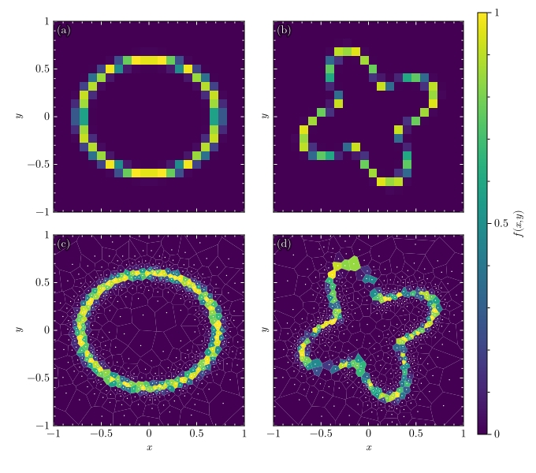
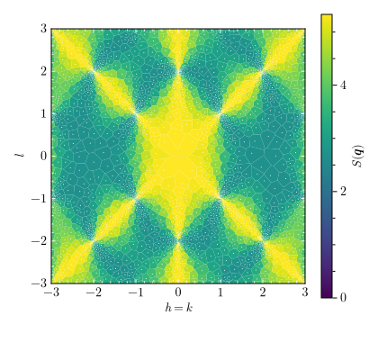

# Learner2D

Adaptive sampling of a function on a rectangle (vector values: see [Learner1D](learner1d.md#Vector-valued-functions)).


```julia
using AdaptivePort

f(x, y) = sin(5x) * cos(7y) + 0.3 * exp(-20 * ((x - 0.3)^2 + (y + 0.2)^2))
learner = Learner2D(f; bounds=((-1, 1), (-0.75, 0.75)))

while !done(learner; tol=0.01) && npoints(learner) < 3000
    points = ask(learner, 5)
    isempty(points) && break
    for (x, y) in points
        tell!(learner, (x, y), f(x, y))
    end
end

data = result(learner)   # (points = Vector of (x, y) tuples, values = Vector), in tell order
tris = triangles(learner) # counter-clockwise index triples into data.points
```

The full script is `examples/learner2d.jl`.

Two thin rings sampled with 784 points on a uniform grid (top) and by `Learner2D` (bottom, Voronoi
cells of the samples), from `examples/learner2d_rings.jl` (`budget = 28^2`):





2000 samples of the neutron structure factor ``S(\mathbf{q})`` of nearest-neighbour classical spin ice in the
self-consistent Gaussian approximation (``T = 0.001`` in units of the effective Ising coupling), in the plane
``q_x = q_y`` of reciprocal space (Voronoi cells of the samples, samples in white). The samples concentrate on
the pinch points (bow-ties) at the reciprocal-lattice points.
`examples/learner2d_spinice.jl` produces the figure.

- Points are `NTuple{2}` tuples `(x, y)` everywhere: `ask` returns them, `tell!` takes them.
- `bounds = ((xmin, xmax), (ymin, ymax))`, finite with `xmin < xmax`, `ymin < ymax`; otherwise
  `ArgumentError`. Any aspect ratio and coordinate scale works: the learner works in scaled
  coordinates where the domain is $[-1/2, 1/2]^2$, as upstream.
- The first four points are the corners, in the order $(x_0, y_0)$, $(x_0, y_1)$, $(x_1, y_0)$,
  $(x_1, y_1)$. Their convex hull is the whole rectangle, so once they are evaluated the
  triangulation covers the domain and no boundary region can be neglected.
- `tell!(learner, (x, y), z)` throws for points outside the bounds. Telling a point again
  overwrites its value (as upstream; `Learner1D` keeps the first value, also as upstream). A
  non-finite `z` is stored but left out of the triangulation.
- `loss(learner)` is `Inf` until the four corners are evaluated, then the largest triangle loss
  (below). `done(learner; tol)` is `loss(learner) <= tol`.
- `result(learner)` returns copies `(points, values)` in tell order; `triangles(learner)` returns
  the Delaunay triangles of the evaluated finite-valued points as index triples into `points`.

### Triangulation

The Delaunay triangulation of the (scaled) points is built with
[DelaunayTriangulation.jl](https://github.com/JuliaGeometry/DelaunayTriangulation.jl), rebuilt from
scratch whenever it is needed (about 15 ms per `ask` at 1000 points). `src/triangulation.jl` is
the only file that uses the package.

### Loss and refinement

The loss of a triangle with area $A$ (in scaled coordinates) is upstream's `default_loss`,
$L = d\sqrt{A} + 0.3A$. Here $d$ estimates the error of linear interpolation on the triangle:
with values $v_i$ normalised by their total range and gradients $g_i$ estimated at the vertices,
$d = \sum_i \max_j \lvert v_i + g_i \cdot (p_j - p_i) - v_j \rvert$ over the vertices $i, j$. The
gradients are a port of scipy's `estimate_gradients_2d_global` (which upstream uses), checked
against scipy to $10^{-14}$. The $d$ term refines curved regions; the $0.3A$ term keeps refining
flat ones. Because coordinates and values are normalised, the loss is a relative quantity,
invariant under rescaling $x$, $y$ or $f$; `tol` in `done` is in these units. It decreases as
points are added, though not monotonically: adding a point changes the gradient estimates and
the value range.

`ask` triangulates the evaluated points together with the pending ones (whose values are linearly
interpolated from the evaluated data, so they add no deviation but split triangles), ranks the
triangles by loss and takes one new point from each of the `n` worst. In a triangle whose
badness $\sqrt{3}\ell^2/(4A)$ ($\ell$ the longest edge) exceeds 5 that point is the midpoint of the
longest edge, otherwise the centroid. If too few distinct points come out, the triangulation is
rebuilt including them and the step repeats.

