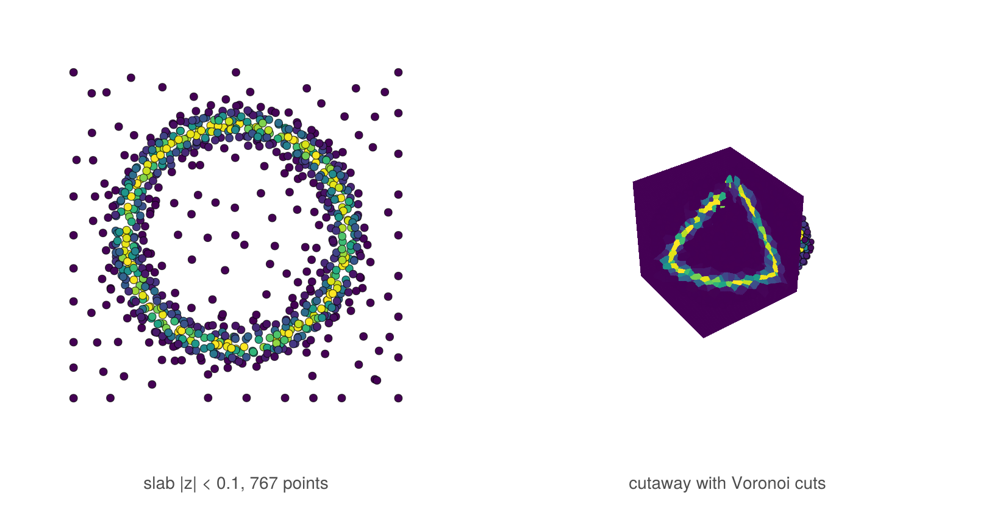

# LearnerND

[`LearnerND`](@ref) samples a function $f: \mathbb{R}^N \to \mathbb{R}^M$ on a box, with scalar
values or `vdim = M` components (see [Vector-valued functions](index.md#Vector-valued-functions)).
Points are `NTuple{N}`.

```julia
using AdaptivePort

f(x, y, z) = tanh(30 * (sqrt(x^2 + y^2 + z^2) - 0.6))   # a thin spherical shell
learner = LearnerND(f; bounds=((-1, 1), (-1, 1), (-1, 1)))

while npoints(learner) < 300
    for p in ask(learner, 6)
        tell!(learner, p, f(p...))
    end
end

data = result(learner)        # (points, values) in tell order
cells = simplices(learner)    # index tuples of length N + 1 into data.points
```

`examples/learnernd.jl` is a longer version, including a vector-valued function.

## Example: a distorted shell



5000 samples of a thin spherical shell whose radius is modulated sinusoidally in the angles. The samples
concentrate on the shell. Left: the samples in the slab ``|z| < 0.1``. Right: the octant facing the camera is
cut open, and its three bounding planes are coloured by the value of the nearest sample (Voronoi cuts of the
data). `examples/learnernd_shell.jl` produces the figure.

## Algorithm

The evaluated points are kept in an incrementally updated Delaunay triangulation
([`AdaptivePort.TriangulationND`](@ref)): a new point deletes the simplices whose circumsphere contains it
and fills the hole with new ones. The Delaunay criterion is evaluated in coordinates scaled by the
box widths, so a box that is not a cube is treated as the unit cube.

Each simplex has a loss. The default is the volume of the simplex in the joint space of inputs and
outputs ([`default_loss_nd`](@ref)): large simplices, and simplices on which $f$ changes a lot, have a
large loss. Coordinates are scaled to the unit cube and the values by their total range (over all
components), so the loss does not depend on units. All losses are recomputed when the range has
grown by more than 10 %. `ask` splits the simplex with the largest loss at its centre, or at the
midpoint of its longest edge if the circumcentre lies outside it.

The first points are the corners of the box, in lexicographic order. While there is no triangulation
yet (fewer than $N + 1$ points not in one hyperplane) a seeded random point is asked.

A pending point subdivides the simplex it lies in, in a small sub-triangulation whose parts share
the parent's loss by volume. Repeated `ask` calls therefore spread out instead of returning one
point again and again. `loss(learner)` is the largest simplex loss, `Inf` until all corners are
told; `loss(learner; real = false)` lets a simplex with pending points count as its largest
sub-simplex.

## Limits

The triangulation locates points by a linear scan and scans the hull, so cost grows quickly with the
dimension (single-threaded, measured):

| $N$ | points | `ask` | `tell!` |
|:---:|:------:|:-----:|:-------:|
| 2 | 1000 | 0.07 ms | 0.03 ms |
| 3 | 1500 | 0.12 ms | 0.45 ms |
| 4 | 600 | 0.55 ms | 5.2 ms |

$N = 5$ is practical for a few hundred points (`tell!` at 300 points takes about 54 ms), $N \ge 6$ is
not (about 0.9 s per `tell!` at 150 points). Differences to upstream are listed under
[Deviations](index.md#Deviations-from-Python-Adaptive).

## API

```@docs
LearnerND
default_loss_nd
uniform_loss_nd
std_loss_nd
simplices
```

### Internals

```@docs
AdaptivePort.TriangulationND
AdaptivePort.add_point!
AdaptivePort.containing
AdaptivePort.circumsphere
AdaptivePort.simplex_volume_in_embedding
AdaptivePort.choose_point_in_simplex
```
