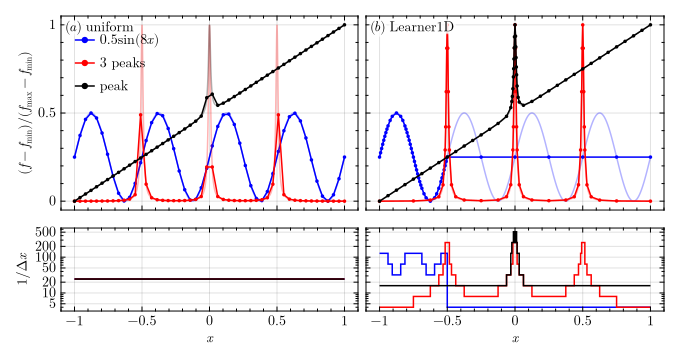

# Learner1D

[`Learner1D`](@ref) samples a function $f(x)$ on an interval $[a, b]$. It refines where the sampled curve is
long, that is where $f$ changes quickly. Points are plain numbers `x`.

```julia
using AdaptivePort

f(x) = sin(8x) + 0.2cos(23x)
learner = Learner1D(f; bounds = (-1, 1))
BlockingRunner(learner; tol = 0.05, max_npoints = 1000)
data = result(learner)   # (x = sorted Vector, y = values)
```

The same with a hand-written loop:

```julia
while !done(learner; tol = 0.05) && npoints(learner) < 1000
    points = ask(learner, 1)
    isempty(points) && break
    for x in points
        tell!(learner, x, f(x))
    end
end
```

The full script is `examples/learner1d.jl` (`julia --project=. examples/learner1d.jl`).



*Uniform and adaptive sampling of three sharp functions with 50 evaluations each, from
`examples/learner1d_plot.jl`.*

## Usage

- `ask(learner, n)` returns up to `n` new points. The first two are the bounds; after that each point is the
  midpoint of the interval with the largest loss. Returned points are *pending*: later calls do not return them
  again, even before they are told. Pass `tell_pending = false` to only peek.
- `tell!(learner, x, y)` records a value. A point outside the bounds throws an `ArgumentError`.
- `loss(learner)` is the largest interval loss, or `Inf` while a bound is not evaluated. `done(learner; tol)` is
  `loss(learner) <= tol`.
- `result(learner)` returns copies `(x, y)` sorted by `x`; `npoints(learner)` counts the points.
- `ask` returns fewer points, eventually none, once intervals are narrower than about `eps` times the interval
  width. A loop should stop when `ask` returns nothing, as above; the runners do this themselves.

!!! warning "A repeated `x` keeps its first value"
    Telling the same `x` twice ignores the second value (as upstream). To average noisy values at the same `x`,
    use [`AverageLearner1D`](@ref).

!!! tip "Choosing `tol`"
    The loss is computed in coordinates where both $x$ and $y$ are scaled to ranges of length 1, so `tol` does not
    depend on the units of $x$ or $f$. With `tol = 0.01` every segment of the sampled curve is shorter than 1 % of
    the size of a plot of the data.

## Vector-valued functions

`Learner1D`, [`Learner2D`](@ref) and [`LearnerND`](@ref) accept functions with several output components: pass
`vdim = M` to the constructor (default 1, plain numbers). Values are then stored as `NTuple{M,T}`, and `tell!`
takes any iterable of length $M$ (a tuple, a vector, ...); a wrong length throws `ArgumentError`. `vdim` is fixed
at construction.

```julia
f(x) = (sin(3x), tanh(60 * (x - 0.3)))
learner = Learner1D(f; bounds = (-1, 1), vdim = 2)
BlockingRunner(learner; max_npoints = 100)
result(learner).y   # Vector of 2-tuples
```

All components share one set of points. Values are scaled by the largest range over the components (as
upstream), so a component with a much smaller range barely steers the sampling.

!!! tip "Components of very different size"
    If one component is much smaller than another but equally important, rescale it inside `f`, for example
    return `(m1, 10 * m2)`.

`examples/vector.jl` runs `Learner1D` and `Learner2D` with `vdim = 2`; the
[phase diagram](../examples/phase_diagram.md) learns two order parameters at once.

## Advanced: custom losses

`loss_per_interval = (xs, ys) -> loss` replaces the default loss of one interval. It receives the two endpoints
and the two values in *scaled* coordinates ($x / (b - a)$ and $y$ divided by the observed $y$-range), as upstream.
With `vdim > 1`, `ys` holds two `NTuple{M}`. A loss that is small for short intervals keeps refining
everywhere; one that only looks at $\Delta y$ stops refining flat regions entirely.

```julia
uniform(xs, ys) = xs[2] - xs[1]       # interval width only: a uniform grid
learner = Learner1D(f; bounds = (-1, 1), loss_per_interval = uniform)
```

!!! danger "Losses must vanish with the interval width"
    A loss like `dx * (1 + abs(dy))` looks reasonable but its `dy` term vanishes as `dx -> 0`, so sampling
    degenerates to a uniform grid. Build losses from scaled coordinates, like [`default_loss`](@ref) (the length
    of the segment), and test them on a steep function such as `tanh(50x)`.

## Advanced: refinement algorithm

Each interval between neighbouring evaluated points has a loss, by default the length of the straight segment
joining its endpoints in coordinates scaled by the width of the bounds and the observed range of `y`. This is
upstream's `default_loss`. Steep regions have long segments and get refined first. The scaled `y`-range is
updated lazily: all losses are recomputed only when the range more than doubles, as upstream does.

`ask` bisects the highest-loss interval, repeatedly. An interval that already contains pending points is split
into sub-intervals that each carry a share of its loss proportional to their width. Ties go to the leftmost
interval. Intervals narrower than about `eps` times the bounds have zero loss and are never split. A `NaN` or
infinite interval loss is ranked by the interval's width instead.

## API

See [`Learner1D`](@ref), [`default_loss`](@ref) and the [common interface](interface.md) in the API reference.
