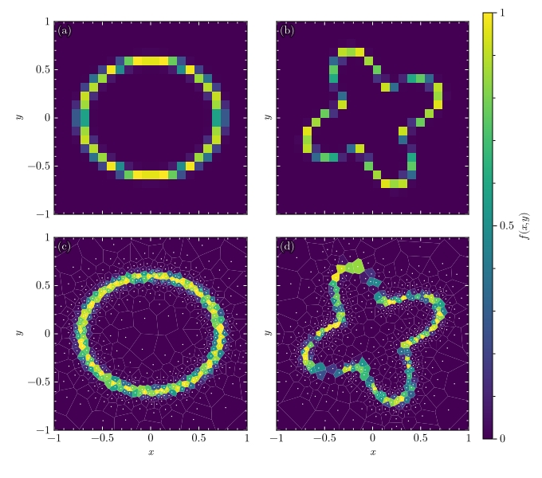

# Learner2D

[`Learner2D`](@ref) samples a function $f(x, y)$ on a rectangle. It triangulates the evaluated points and
refines the triangles where linear interpolation is worst. Points are tuples `(x, y)`. For vector values
(`vdim`) see [Vector-valued functions](learner1d.md#Vector-valued-functions).

```julia
using AdaptivePort

f(x, y) = sin(5x) * cos(7y) + 0.3 * exp(-20 * ((x - 0.3)^2 + (y + 0.2)^2))
learner = Learner2D(f; bounds = ((-1, 1), (-0.75, 0.75)))
BlockingRunner(learner; tol = 0.01, max_npoints = 3000)

data = result(learner)     # (points = Vector of (x, y) tuples, values = Vector), in tell order
tris = triangles(learner)  # counter-clockwise index triples into data.points
```

By hand, note the tuple points:

```julia
while !done(learner; tol = 0.01) && npoints(learner) < 3000
    points = ask(learner, 5)
    isempty(points) && break
    for (x, y) in points
        tell!(learner, (x, y), f(x, y))
    end
end
```

The full script is `examples/learner2d.jl`.



*Two thin rings with 784 evaluations each. Top: uniform grid. Bottom: `Learner2D`, shown as the Voronoi cells
of the samples. From `examples/learner2d_rings.jl`; more figures in [Plotting results](../examples/plotting.md).*

## Usage

- `bounds = ((xmin, xmax), (ymin, ymax))`, finite with `xmin < xmax` and `ymin < ymax`, otherwise
  `ArgumentError`. Any aspect ratio and scale works: the learner maps the domain to $[-1/2, 1/2]^2$, as upstream.
- The first four points are the corners, in the order $(x_0, y_0)$, $(x_0, y_1)$, $(x_1, y_0)$, $(x_1, y_1)$.
  Once they are evaluated, the triangulation covers the whole rectangle and no boundary region is missed.
- `tell!(learner, (x, y), z)` throws for points outside the bounds. A non-finite `z` is stored but left out of the
  triangulation.
- `loss(learner)` is `Inf` until the four corners are evaluated, then the largest triangle loss.
  `done(learner; tol)` is `loss(learner) <= tol`.
- `result(learner)` returns copies `(points, values)` in tell order; [`triangles`](@ref) returns the Delaunay
  triangles of the evaluated finite-valued points as index triples into `points`.

!!! warning "A repeated point overwrites its value"
    Telling the same `(x, y)` again replaces the stored value (as upstream). This differs from `Learner1D`, which
    keeps the first value (also as upstream).

!!! tip "Choosing `tol`"
    Coordinates and values are normalised, so the loss is relative: it does not change if you rescale $x$, $y$
    or $f$. It decreases as points are added, but not monotonically, because new points change the gradient
    estimates and the value range. Combine `tol` with `max_npoints`.

!!! note "Cost grows with the number of points"
    Every `ask` and every `loss` rebuilds the triangulation from scratch (about 7 to 10 ms at 1000 points). A run
    asking one point at a time averages about 5 ms per point up to 1000 points and 15 ms up to 3000. That is
    negligible for an expensive `f`; parallel runners ask in batches, see
    [Parallel execution](../runners/parallel.md).

## Advanced: loss and refinement

The loss of a triangle with area $A$ (in scaled coordinates) is upstream's `default_loss`,
$L = d\sqrt{A} + 0.3A$. Here $d$ estimates the error of linear interpolation on the triangle. With values $v_i$
normalised by their total range and gradients $g_i$ estimated at the vertices $p_i$,

$$d = \sum_i \max_j \lvert v_i + g_i \cdot (p_j - p_i) - v_j \rvert$$

over the vertices $i, j$. The gradients are a port of scipy's `estimate_gradients_2d_global` (which upstream
uses), checked against scipy to $10^{-14}$. The $d$ term refines curved regions; the $0.3A$ term keeps refining
flat ones.

`ask` triangulates the evaluated points together with the pending ones (whose values are linearly interpolated
from the evaluated data, so they add no deviation but split triangles), ranks the triangles by loss and takes one
new point from each of the `n` worst. In a triangle whose badness $\sqrt{3}\ell^2/(4A)$ ($\ell$ the longest edge)
exceeds 5, that point is the midpoint of the longest edge, otherwise the centroid. If too few distinct points come
out, the triangulation is rebuilt including them and the step repeats.

A custom loss is passed as `loss_per_triangle = (points, values, triangles) -> Vector` of per-triangle losses. It
gets the points in scaled coordinates, raw values (`NTuple{M}` for `vdim = M`) and counter-clockwise index
triples.

## Advanced: triangulation

The Delaunay triangulation of the scaled points is built with
[DelaunayTriangulation.jl](https://github.com/JuliaGeometry/DelaunayTriangulation.jl) and rebuilt from scratch
whenever it is needed. `src/triangulation.jl` is the only file that uses the package.

## API

See [`Learner2D`](@ref), [`triangles`](@ref), [`default_loss`](@ref) and the [common interface](interface.md).
